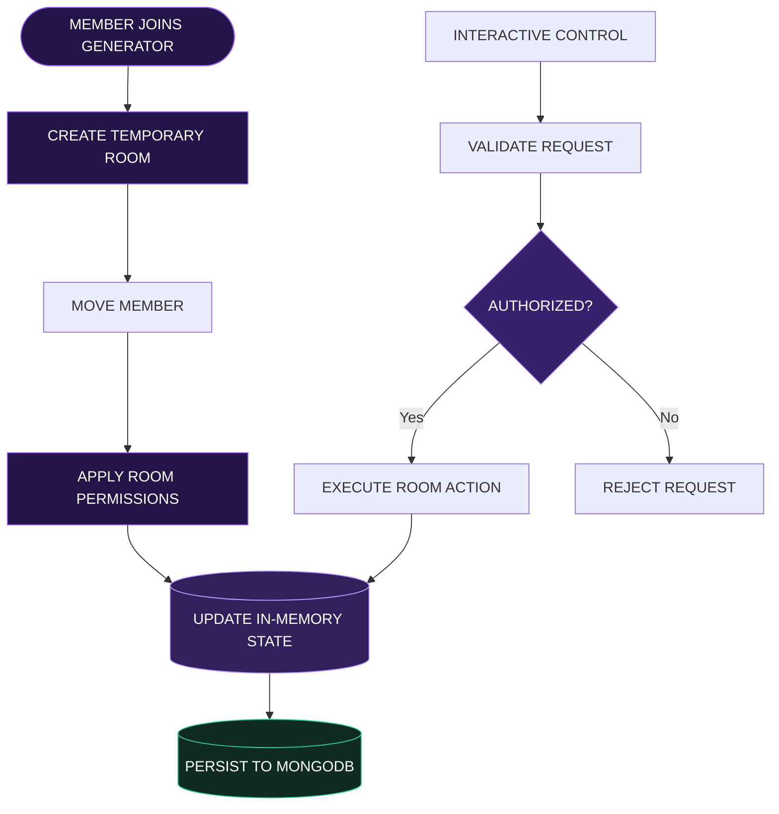

# 🎙️ Bryan Voice

<div align="center">

<a href="https://github.com/YOUR_USERNAME/bryan-voice">

</a>

<br/>


<br/><br/>

<a href="https://discord.js.org/"></a>
<a href="https://www.typescriptlang.org/"></a>
<a href="https://nodejs.org/"></a>
<a href="https://www.mongodb.com/"></a>
<a href="LICENSE"></a>

<br/><br/>

**Not just another voice bot. A better way to control your server's voice experience.**

Create temporary voice rooms, manage access, customize permissions, and keep your community organized through a streamlined Discord experience.

<br/>

<a href="#-experience"></a>
<a href="#-quick-start"></a>

<br/><br/>


</div>

---

<div align="center">

## ✦ THE BRYAN VOICE EXPERIENCE

<sub>PRECISION · CONTROL · SIMPLICITY</sub>

</div>

<table>
<tr>
<td width="50%" valign="top">

<h3>⚡ Instant Room Creation</h3>

Create temporary voice rooms when members join a configured generator. Automatically move members into their new rooms.

</td>
<td width="50%" valign="top">

<h3>🎛️ Total Room Control</h3>

Lock, unlock, hide, rename, limit, and manage room access through commands and interactive controls.

</td>
</tr>
<tr>
<td width="50%" valign="top">

<h3>🛡️ Intelligent Protection</h3>

Support room-level anti-abuse controls, access checks, and moderation actions for private voice spaces.

</td>
<td width="50%" valign="top">

<h3>👑 Ownership Management</h3>

Handle room ownership changes and allow eligible members to claim abandoned rooms.

</td>
</tr>
<tr>
<td width="50%" valign="top">

<h3>💾 Cache-First Architecture</h3>

Use in-memory state for frequent operations and MongoDB for persistent configuration and data.

</td>
<td width="50%" valign="top">

<h3>🎨 Custom Visual Identity</h3>

Synchronize custom application emojis where supported, with fallbacks when an emoji is unavailable.

</td>
</tr>
</table>

<div align="center">


</div>

## ◈ Architecture

Bryan Voice is designed around responsive Discord interactions, room ownership checks, temporary channel lifecycle management, and persistent configuration.



### Performance philosophy

| Component | Objective |
|---|---|
| Interaction handling | Respond promptly and acknowledge interactions appropriately |
| Channel lifecycle | Minimize unnecessary Discord API operations |
| Authorization | Validate ownership and permissions before changes |
| State management | Cache frequently accessed data |
| Persistence | Handle database failures without silently losing data |
| Reliability | Handle API errors, rate limits, and stale rooms |

> Actual latency, CPU consumption, and memory usage depend on the implementation and deployment environment. Add verified benchmark results here when available.

---

## ◈ Quick Start

<div align="center">

<sub>GET UP AND RUNNING IN FOUR STEPS</sub>

</div>

### 01 — Clone the repository

```bash
git clone https://github.com/YOUR_USERNAME/bryan-voice.git
cd bryan-voice
```

### 02 — Install dependencies

```bash
npm install
```

### 03 — Configure your environment

```bash
cp .env.example .env
```

Add your credentials to `.env`:

```ini
DISCORD_TOKEN=your_bot_token_here
CLIENT_ID=your_client_id_here
MONGODB_URI=mongodb://localhost:27017/bryan_voice
DEFAULT_PREFIX=.v
AUTO_LOAD_EMOJIS=true
```

### 04 — Build and launch

```bash
npm run build
npm start
```

These commands assume the repository has the listed files and npm scripts. Replace the repository URL and adjust the commands to match your actual project.

---

## ◈ Command Center

<details open>
<summary><strong>🎙️ Voice Room Controls</strong></summary>

| Command | Action |
|---|---|
| `.v setup` | Configure generators, categories, themes, and panels |
| `.v panel` | Send the voice management panel |
| `.v needhelp` | Move to the configured help voice room |
| `.v lock` | Restrict new connections |
| `.v unlock` | Reopen the room |
| `.v hide` | Hide the room from unauthorized members |
| `.v unhide` | Restore room visibility |
| `.v name <name>` | Rename the room |
| `.v limit <0-99>` | Change the member limit |
| `.v permit <@user>` | Grant a user access |
| `.v reject <@user>` | Deny access to a user |
| `.v claim` | Claim an eligible abandoned room |
| `.v info` | Display room details |
| `.v ab` | Toggle anti-abuse protection |

</details>

<details>
<summary><strong>🔐 Discord Application Requirements</strong></summary>

Configure your application in the [Discord Developer Portal](https://discord.com/developers/applications).

Enable only the privileged intents your implementation actually requires:

- **Message Content Intent** for ordinary prefix-command parsing.
- **Server Members Intent** for features that depend on privileged member data or events.
- **Presence Intent** for presence-dependent functionality.

Grant only the bot permissions needed for its configured features. Avoid granting Administrator by default.

</details>

<details>
<summary><strong>🧰 Production Checklist</strong></summary>

- [ ] Store secrets outside source control.
- [ ] Validate room ownership and permissions on every relevant action.
- [ ] Handle Discord rate limits and API failures.
- [ ] Clean up empty temporary channels.
- [ ] Recover gracefully from process restarts.
- [ ] Test ownership transfers and permission overwrites.
- [ ] Monitor errors and database connectivity.
- [ ] Measure real performance before publishing benchmarks.

</details>

---

## ◈ Project Configuration

| Setting | Description |
|---|---|
| `DISCORD_TOKEN` | Bot authentication token |
| `CLIENT_ID` | Discord application identifier |
| `MONGODB_URI` | MongoDB connection string |
| `DEFAULT_PREFIX` | Default text-command prefix |
| `AUTO_LOAD_EMOJIS` | Toggle automatic emoji synchronization |

**Security note:** Never commit `.env` files or publish bot tokens. If a token is exposed, reset it immediately.

---

## ◈ Contributing

Want to improve Bryan Voice?

1. Fork the repository.
2. Create a feature branch.
3. Implement and test your changes.
4. Open a pull request with a clear description.

Bug reports and practical improvements are welcome.

## ◈ License

Bryan Voice is distributed under the **MIT License**. See [`LICENSE`](LICENSE) for the full license text.

<div align="center">


<br/>

<sub>CRAFTED FOR COMMUNITIES. BUILT FOR CONTROL.</sub>

</div>
