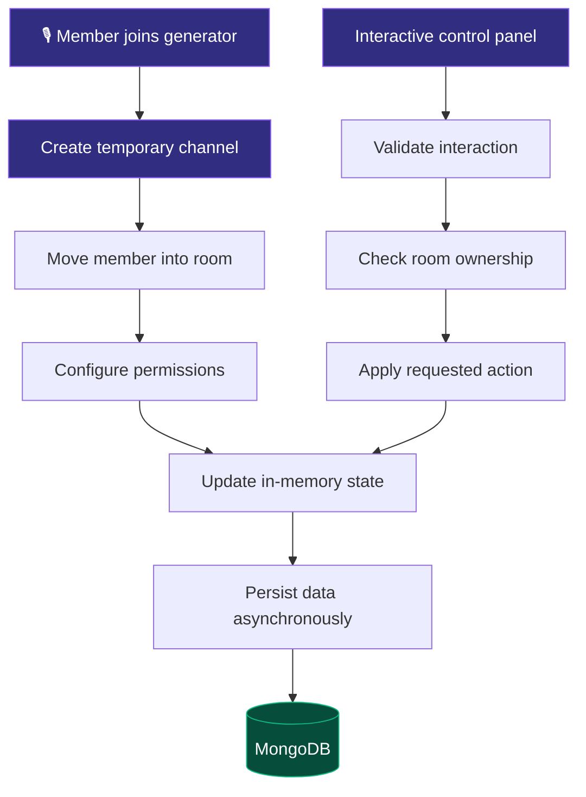

# 🎙️ One Tap Voice

<div align="center">


<a href="https://discord.js.org/"></a>
<a href="https://www.typescriptlang.org/"></a>
<a href="https://nodejs.org/"></a>
<a href="https://www.mongodb.com/"></a>
<a href="LICENSE"></a>

<br/>

**A modern temporary voice channel management bot for Discord.**

Create private rooms, manage permissions, control access, and give your community a seamless voice experience — all through one tap.

[Features](#-features) · [Architecture](#-architecture) · [Installation](#-installation) · [Commands](#-commands) · [Configuration](#-configuration)

<br/>


</div>

---

## ✨ Features

<table>
<tr>
<td width="50%" valign="top">

### ⚡ Instant Room Creation

Automatically create temporary voice channels when users join a configured generator, then move them into their new rooms.

### 🎛️ Interactive Control Panels

Give room owners convenient controls for locking, hiding, renaming, and managing their channels.

### 🛡️ Anti-Abuse Protection

Help prevent unwanted users from repeatedly joining private rooms with configurable protection and moderation controls.

</td>
<td width="50%" valign="top">

### 👑 Smart Room Ownership

Manage ownership when a room owner leaves, allowing eligible members to claim abandoned rooms.

### 💾 Persistent Configuration

Use an in-memory cache for fast access and MongoDB for persistent configuration and room-related data.

### 🎨 Dynamic Emoji Support

Synchronize application emojis when configured, with fallback support for unavailable custom emojis.

</td>
</tr>
</table>

<div align="center">


</div>

## 🏗️ Architecture

One Tap Voice separates voice-channel operations from persistence so routine interactions can use cached state rather than waiting for database reads.



### ⚙️ Performance Goals

| Area | Design objective |
|---|---|
| Room creation | Minimize unnecessary API operations |
| Interaction handling | Acknowledge interactions promptly |
| State management | Cache frequently accessed data |
| Persistence | Keep database operations off latency-sensitive paths where possible |
| Process management | Support production deployment with a process manager |

> **Benchmarking note:** Actual latency, memory usage, and CPU consumption depend on server load, network conditions, enabled features, and deployment configuration. Publish measured figures only after testing the running bot.

## 📋 Commands

<details open>
<summary><strong>🎙️ Voice Channel Management</strong></summary>

| Command | Description |
|---|---|
| `.v setup` | Configure generators, categories, themes, and panels |
| `.v panel` | Send the voice control panel |
| `.v needhelp` | Move to the configured help voice room, subject to cooldown |
| `.v lock` | Prevent unauthorized users from joining |
| `.v unlock` | Allow users to join again |
| `.v hide` | Hide the room from users without access |
| `.v unhide` | Restore room visibility |
| `.v name <name>` | Change the room name |
| `.v limit <0-99>` | Set the maximum member count |
| `.v permit <@user>` | Allow a specified user into the room |
| `.v reject <@user>` | Remove or deny access to a specified user |
| `.v claim` | Claim an eligible abandoned room |
| `.v info` | Display room information and available statistics |
| `.v ab` | Toggle the room's anti-abuse protection |

</details>

> Commands and permissions must match the implementation. Prefix commands require message-based command handling and the appropriate Discord intents.

## 🚀 Installation

### Prerequisites

- Node.js 18 or later
- npm
- A Discord application and bot token
- A MongoDB instance
- Git

### 1. Clone the repository

Replace `YOUR_USERNAME` with your actual GitHub username.

```bash
git clone https://github.com/YOUR_USERNAME/onetap-voice.git
cd onetap-voice
```

### 2. Install dependencies

```bash
npm install
```

### 3. Configure environment variables

Create your environment file from the example:

```bash
cp .env.example .env
```

Add your configuration:

```ini
DISCORD_TOKEN=your_bot_token_here
CLIENT_ID=your_client_id_here
MONGODB_URI=mongodb://localhost:27017/onetap_voice
DEFAULT_PREFIX=.v
AUTO_LOAD_EMOJIS=true
```

Keep your `.env` file private. Never commit bot tokens, database credentials, or other secrets to GitHub.

### 4. Build and start

```bash
npm run build
npm start
```

The commands above assume that your `package.json` defines the corresponding scripts. Check your project configuration if they differ.

## 🔧 Configuration

| Variable | Purpose |
|---|---|
| `DISCORD_TOKEN` | Authenticates the Discord bot |
| `CLIENT_ID` | Identifies your Discord application |
| `MONGODB_URI` | Connects to the MongoDB database |
| `DEFAULT_PREFIX` | Sets the default text-command prefix |
| `AUTO_LOAD_EMOJIS` | Enables or disables automatic emoji synchronization |

Do not share your token publicly. If it is exposed, reset it immediately in the Discord Developer Portal.

## 🔐 Discord Developer Portal

Open the [Discord Developer Portal](https://discord.com/developers/applications), select your application, and review its bot settings.

Enable the following privileged intents only when your implementation requires them:

- **Message Content Intent** — required for reading ordinary message content for prefix commands.
- **Server Members Intent** — required for features that depend on privileged guild-member events or member data.
- **Presence Intent** — required only for presence-related functionality.

Also configure the bot's server permissions according to its actual features. Avoid granting Administrator unless it is genuinely necessary.

## 📦 Recommended Production Practices

- Validate interaction permissions and room ownership before modifying channels.
- Handle Discord API errors, rate limits, and failed channel operations.
- Keep database credentials and bot tokens in environment variables.
- Use structured logging and graceful shutdown handling.
- Test ownership transfers, permission overwrites, and bot restarts.
- Verify cleanup of empty temporary channels and stale cache entries.
- Measure performance under realistic concurrent workloads before publishing benchmarks.

## 🤝 Contributing

Contributions, bug reports, and improvements are welcome.

1. Fork the repository.
2. Create a feature branch.
3. Make and test your changes.
4. Submit a pull request describing the change.

## 📄 License

This project is distributed under the MIT License. See [`LICENSE`](LICENSE) for the full license text.

---

<div align="center">


**One Tap Voice — Your Voice. Your Rules.**

<sub>Designed for communities that want better voice management.</sub>

</div>
